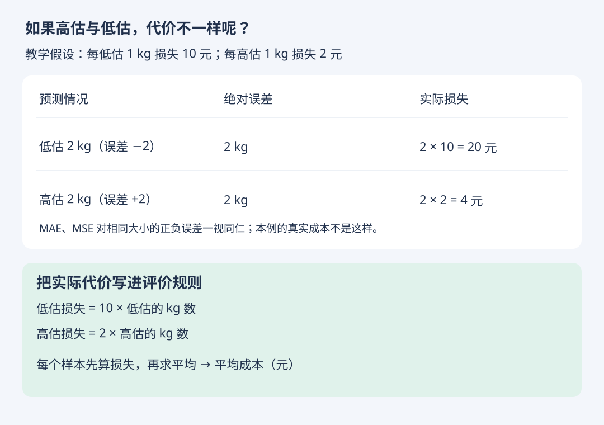
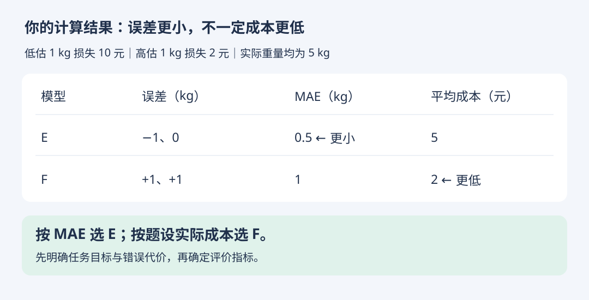

# 补充应用：高估与低估代价不同

- 学习日期：2026-10-18
- 状态：练习已答对（2026-10-18）
- 这是性能度量的应用补充，不代表原书新增章节。
- [上一节：MAE 与 MSE](mae-vs-mse.md) · [HTML 图解版](asymmetric-cost.html)

## 1. 为什么需要新的评价规则

上一题中，高估和低估每差 1 kg 的成本相同，平均成本等于 2 元/kg × MAE。

现在更改教学假设：每低估 1 kg 损失 10 元，每高估 1 kg 损失 2 元。误差仍定义为预测减实际。



MAE 对 +2 kg 和 -2 kg 都记 2 kg；MSE 都记 4 kg²。但本题实际损失分别是 4 元与 20 元。这两种指标不能直接表达本题的方向差异。

## 2. 定义成本

```text
e = 预测重量 - 实际重量
单次损失（元） = 10 × max(-e, 0) + 2 × max(e, 0)
平均成本 = 所有样本的单次损失之和 / 样本数
```

式中的 10 与 2 的单位是元/kg；e 的单位是 kg。e=0 时损失为 0。这里假设损失随误差大小分段线性增长；实际任务应根据真实代价定义。

评价标准应事先明确，用验证集选择模型与方案，保留测试集评估最终结果。也可把这样的损失用于训练；本节先只讨论评价。

## 3. 练习（已答对）

两个包裹实际都为 5 kg：

| 模型 | 第一个预测 | 第二个预测 |
| --- | --- | --- |
| E | 4 kg | 5 kg |
| F | 6 kg | 6 kg |

仍按低估每 kg 损失 10 元、高估每 kg 损失 2 元：

1. E、F 的 MAE 分别是多少？
2. E、F 的平均成本分别是多少？
3. 按 MAE 与按平均成本，选择是否相同？

### 学习者回答与反馈

E 的 MAE 为 0.5 kg，平均成本为 5 元；F 的 MAE 为 1 kg，平均成本为 2 元。因此按 MAE 选 E，按平均成本选 F。反馈：计算与解释全部正确。

## 4. 结果对照



| 模型 | 误差 kg | MAE kg | 两次损失 元 | 平均成本 元 |
| --- | --- | --- | --- | --- |
| E | -1、0 | 0.5 | 10、0 | 5 |
| F | +1、+1 | 1 | 2、2 | 2 |

结论：指标选择要体现真实任务的代价；平均误差较小，不一定意味着实际损失较小。此结论仅比较题设中的数据与成本规则。

### 衔接：评估结果是否稳定（待讨论）

同一任务中，模型 A、B 在某次留出的测试数据上准确率分别为 91%、90%。仅凭这一次结果，能否断定 A 在未来数据上一定更好？后续返回第二章的评估方法与比较检验。
