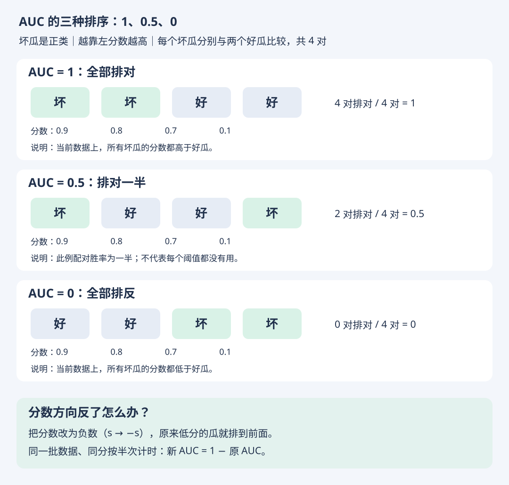

# AUC 的边界：1、0.5、0 与分数方向

- 学习日期：2026-10-17
- 状态：本节已讲解，练习待回答
- [上一节：AUC 怎么算](roc-auc.md) · [HTML 图解版](auc-ranking.html) · [返回第二章](02-模型评估与选择.md)

## 1. 先固定分数的含义

仍把坏瓜作为正类，约定分数越高，越认为是坏瓜。下面都是两个坏瓜、两个好瓜，因此正负配对总数为 2 × 2 = 4。



## 2. 三种排序

表中的顺序均按模型分数从高到低排列，分数依次为 0.9、0.8、0.7、0.1。

| 从高分到低分 | 排对的正负配对 | 总配对 | AUC |
| --- | --- | --- | --- |
| 坏、坏、好、好 | 4 | 4 | 1 |
| 坏、好、好、坏 | 2 | 4 | 0.5 |
| 好、好、坏、坏 | 0 | 4 | 0 |

第一行已由学习者正确回答：4 对全对，AUC = 1。

第二行中，排第一的坏瓜战胜两个好瓜，排最后的坏瓜输给两个好瓜，所以 AUC = 2 / 4 = 0.5。

第三行中，两个坏瓜都输给两个好瓜，所以 AUC = 0。

## 3. AUC = 0.5 要怎样理解

独立随机打分的 AUC 期望为 0.5，但一次有限样本评估不一定恰好得到 0.5。

反过来，一次得到 AUC = 0.5，也不能仅凭这个数断定模型分数完全随机，或者每个阈值下都没有用。图中的第二行是一个明确的排序例子：配对胜率一半，但最高分的那个瓜仍是坏瓜。

## 4. AUC 很低，先检查分数方向

如果误把“好瓜分数”当作“坏瓜分数”，就可能看到很低的 AUC。评估前要确认正类和分数的含义。

同一批同时包含正负类的数据上，把分数 s 改为 -s，会反转全部不相等的排序，并保留同分。按同分计半次的规则：

```text
AUC(-s) = 1 - AUC(s)
```

因此 0.1 反向后是 0.9；0 反向后是 1；0.5 反向后仍是 0.5。只有分数确实处于 0～1 时，才也可以用 1-s 反向；一般分数用 -s 即可。

不要根据最终测试集的成绩反复挑选方向。分数含义应预先确定，需要比较的方案应在验证集上选择；测试集保留给最终评估。

## 5. 边界与实际使用

- AUC = 1：只表示当前评估数据的排序完美，不保证新数据也完美。
- AUC 衡量排序，不衡量预测概率是否准确，也不直接指定使用阈值。
- 仅有一个类别的数据，无法按正负配对定义计算 ROC-AUC。

## 6. 练习（待回答）

一个模型输出的是“好瓜分数”，越高越认为是好瓜；但我们评估时把坏瓜设为正类，直接输入该分数，得到 AUC = 0.1。

1. 这能否直接说明模型完全没用？
2. 把分数改为 -s，且使用同一批数据，新的 AUC 是多少？

本笔记为教学示例，不包含原书 PDF。
