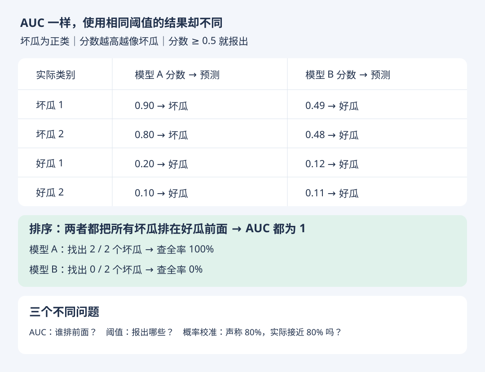

# AUC、阈值与概率：三个不同的问题

- 学习日期：2026-10-18
- 状态：练习在 GPT 辅助下完成，待独立复测
- [上一节](auc-ranking.md) · [HTML 图解版](auc-threshold.html)

## 1. 相同 AUC，不同预测结果

约定坏瓜为正类，分数越高越像坏瓜，分数达到 0.5 就报出。下图是教学数据，不表示真实概率。

两者都将两个坏瓜排在两个好瓜前面，4 个正负配对全部排对，AUC 均为 1。

但阈值同为 0.5 时，A 找到全部坏瓜，B 一个也没找到。模型 B 分数较低，不等于排序差；可以在验证集上选择合适的阈值。当前四个瓜的结果仅用于说明，不代表未来表现。

## 2. 三个问题分别看什么

| 问题 | 看什么 |
| --- | --- |
| 坏瓜是否排在好瓜前面？ | AUC 等排序指标 |
| 使用当前阈值，能找到多少、误报多少？ | 查全率、查准率、FPR 等 |
| 输出的概率能否当作可信的发生频率？ | 概率校准 |

例如，模型给很多瓜预测“坏瓜概率约 80%”，如果这些瓜中实际约 80% 是坏瓜，说明它在这一概率范围的校准较好。不能根据一个瓜判断校准，也不能仅凭 AUC 判断概率准不准。

AUC 只依赖分数的相对排序；严格递增的变换保持排序与同分关系，所以保持 AUC，却可能改变某个固定数值阈值下的分类结果。

## 3. 小练习（已答对）

只针对图中的四个瓜：把模型 B 的阈值从 0.5 降到 0.3，分数大于或等于阈值即报出。

1. 会报出哪些瓜？
2. 查全率与假正例率分别是多少？
3. AUC 会改变吗？（模型分数保持不变，只调整判断阈值。）

选择阈值属于模型方案选择，通常使用验证集；不要反复根据最终测试集挑阈值。

### 学习者回答与反馈

回答：报出两个坏瓜，查全率 100%，假正例率 0%，AUC 不变，仍为 1。

反馈：全部正确。只调整阈值，没有改变用于计算 ROC-AUC 的分数及其排序，因此 AUC 不变。

## 4. ROC 与 AUC 是评估工具

学习者进一步提出：这些指标只是工具。这里将对话中的“AOC”按上下文理解为“ROC”。

- ROC 是描述不同阈值下真正例率与假正例率关系的曲线。
- AUC 是该 ROC 曲线下的面积，用一个数概括整体排序能力。
- 它们不直接决定模型能否使用。选择还需结合漏检、误报代价，目标查全率和复查能力等约束。
- AUC 高不等于任意阈值下都好，也不等于概率准确；满足真实任务要求才是评价的目的。

## 学习状态更正 · 2026-10-18

学习者说明：前面的计算题由 GPT 辅助回答，独立计算尚不熟练；ROC/AUC 目前主要理解为评估工具；MSE/RMSE 目前主要理解为越小越好；MAE 的用途仍需从直觉重讲。

因此，前面的正确答案仅记录“辅助下完成”，不作为独立掌握的证据。后续先练含义、分母、单位，再练简单计算；独立复测前不标记已掌握。
