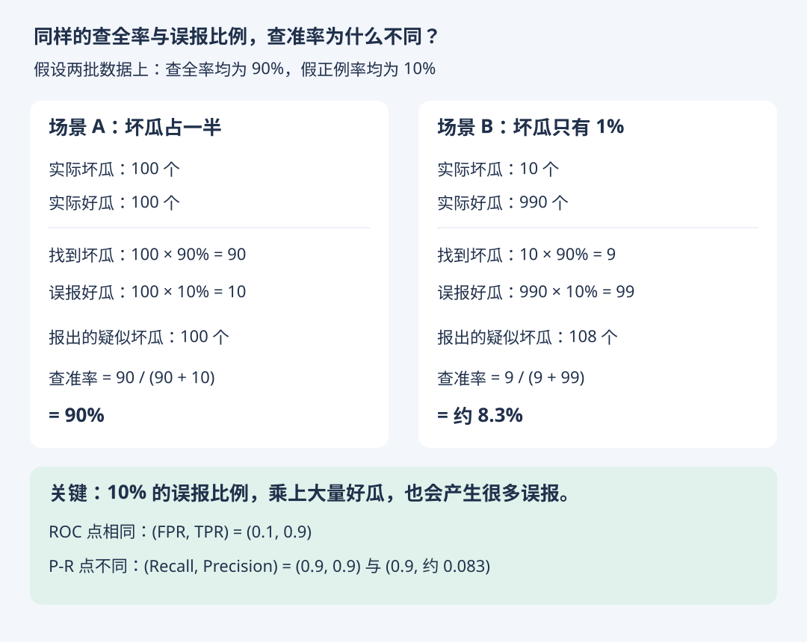
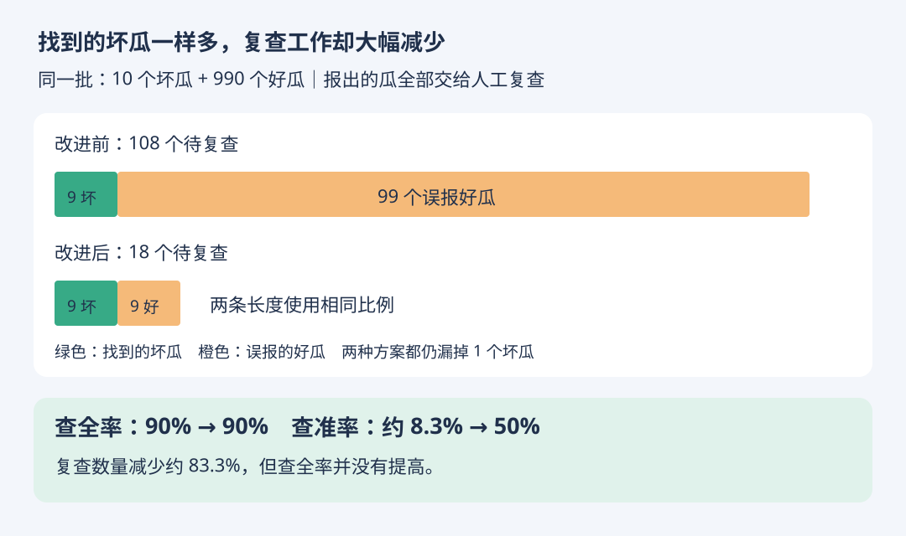

# 类别不平衡：为什么还要看查准率与 P-R 曲线

- 学习日期：2026-10-18
- 状态：练习在 GPT 辅助下完成，待独立复测
- [上一节：AUC 与阈值](auc-threshold.md) · [HTML 图解版](class-imbalance.html)

## 1. 同样的 TPR 与 FPR，不同的查准率

坏瓜是正类。为单独观察类别比例的影响，假设模型在两批数据上都达到查全率 90%、假正例率 10%。实际换场景后这两个比率不一定保持不变。



| 场景 | 实际坏瓜 | 实际好瓜 | 找出的坏瓜 TP | 误报的好瓜 FP | 查准率 |
| --- | --- | --- | --- | --- | --- |
| A | 100 | 100 | 90 | 10 | 90 / 100 = 90% |
| B | 10 | 990 | 9 | 99 | 9 / 108 ≈ 8.3% |

场景 B 报出的 108 个疑似坏瓜中，只有 9 个是真的坏瓜。即使 FPR 只有 10%，乘上大量好瓜后也会产生 99 个误报。

## 2. ROC 与 P-R 的不同视角

- ROC 横轴 FPR、纵轴 TPR：分别以实际负类、实际正类为分母。
- P-R 横轴 Recall、纵轴 Precision：直接观察找全程度与报出结果的可信程度。
- 上例 ROC 点相同，但 P-R 点不同。一个 ROC 点不能决定整条 ROC 曲线或 AUC。
- 正类稀少时，结合 P-R 曲线、误报数量与业务成本，更容易发现实际使用的问题；ROC-AUC 仍有价值。
- 不同正类比例的数据集上，查准率和 P-R 表现不宜脱离背景直接比较。评估数据应尽量反映部署场景。

## 3. 可选公式

令 p 为正类比例，t 为 TPR，f 为 FPR，则在分母非零时：

```text
Precision = (t × p) / (t × p + f × (1 - p))
```

不必背公式：分子是找到的正类比例，分母是所有报出样本的比例。

## 4. 练习（已答对）

有 10 个坏瓜、990 个好瓜。假设改进后的模型仍能找出 9 个坏瓜，但只误报 9 个好瓜。

1. 查全率是多少？
2. 查准率是多少？
3. 假正例率是多少？

注意：查准率的分母是所有报出的瓜，假正例率的分母是实际好瓜。

### 学习者回答

- 查全率：9 / 10 = 90%。
- 查准率：9 / (9 + 9) = 50%。
- 假正例率：9 / 990 ≈ 0.91%。

反馈：全部正确，三个指标的分母都区分清楚了。

## 5. 改进前后对照



| 项目 | 改进前 | 改进后 |
| --- | --- | --- |
| 找到的坏瓜 TP | 9 | 9 |
| 漏掉的坏瓜 FN | 1 | 1 |
| 误报的好瓜 FP | 99 | 9 |
| 报出总数（假设全部交给人工复查） | 108 | 18 |
| 查全率 | 90% | 90% |
| 查准率 | 约 8.3% | 50% |
| 假正例率 | 10% | 约 0.91% |

在这批数据上，同样找到 9 个坏瓜，人工复查数量从 108 降至 18，减少约 83.3%。没有证明新模型在所有数据或阈值下都更好，也不能只凭这两个工作点比较整体 AUC。

### 下一问（已答对）

如果每天最多能人工复查 20 个瓜，而商家要求至少找到 95% 的坏瓜，改进后这组结果是否同时满足两个要求？分别判断复查数量与查全率。

学习者回答：不能同时满足；复查 18 个不超过 20 个，但查全率 90% 达不到 95%。反馈：正确，应分别检查每项约束，不能用复查数量达标抵消查全率不达标。

## 学习状态更正 · 2026-10-18

学习者说明：前面的计算题由 GPT 辅助回答，独立计算尚不熟练；ROC/AUC 目前主要理解为评估工具；MSE/RMSE 目前主要理解为越小越好；MAE 的用途仍需从直觉重讲。

因此，前面的正确答案仅记录“辅助下完成”，不作为独立掌握的证据。后续先练含义、分母、单位，再练简单计算；独立复测前不标记已掌握。
