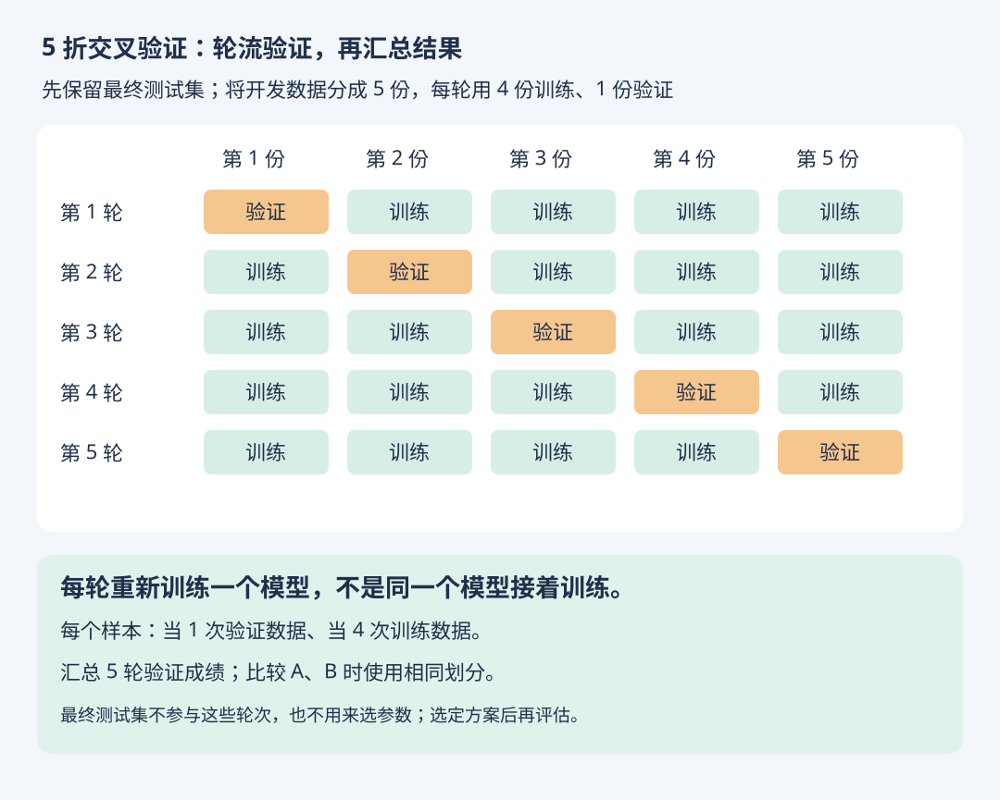

# 评估稳定性与 5 折交叉验证

- 学习日期：2026-10-18
- 状态：已讲解，练习待回答
- [HTML 图解版](cross-validation.html) · [返回第二章](02-模型评估与选择.md)

## 1. 一次领先不等于未来一定领先

A、B 在一次测试中分别达到 91%、90%，这个差异可能受样本数量、抽样组成和训练随机性影响。更多有代表性的数据、合理的重复评估与比较检验可帮助判断可靠性，但不能保证未来一定更好。

## 2. 交叉验证怎么做

这里采用“先保留最终测试集，在其余开发数据上交叉验证”的完整工作流程。将开发数据分为 5 份，依次轮流拿 1 份验证，另外 4 份训练，进行 5 轮。

- 每轮从头训练，不沿用上一轮已训练的模型。
- 每个样本参与 1 次验证、4 次训练。
- 可报告各折成绩与均值，观察波动；不要只挑最好的一轮。
- 比较模型时采用相同的折划分，减少划分差异造成的干扰。
- 选择模型与参数后，用全部开发数据重新训练最终模型，再评估保留的测试集。

书中不同语境可能将每折留出数据称为测试部分；本笔记为避免与最终测试集混淆，称其为“验证折”。

## 3. 仍要遵守数据边界

- 每折的缺失值填补、标准化等都只在该折训练部分拟合，再应用到验证折。
- 分类任务可用分层划分尽量保持类别比例，但还要满足对象、时间等约束。
- 同一病人或同一西瓜的多张图片，应按对象分组划分。
- 预测未来应使用遵循时间顺序的验证方法，不能直接套用随机 5 折。
- 各折训练数据互有重叠，折成绩不等于独立重复实验；不能把它们直接当成独立样本套用所有检验。后续再学比较检验。

## 4. 小练习（待回答）

先保留独立的最终测试集，剩下 1,000 条开发数据，等分做 5 折交叉验证。

1. 每轮有多少条训练数据、多少条验证数据？
2. 总共需要训练几次？每条开发数据参与几次验证？
3. 最终测试集要不要加入这 5 轮？

## 学习状态更正 · 2026-10-18

学习者说明：前面的计算题由 GPT 辅助回答，独立计算尚不熟练；ROC/AUC 目前主要理解为评估工具；MSE/RMSE 目前主要理解为越小越好；MAE 的用途仍需从直觉重讲。

因此，前面的正确答案仅记录“辅助下完成”，不作为独立掌握的证据。后续先练含义、分母、单位，再练简单计算；独立复测前不标记已掌握。
