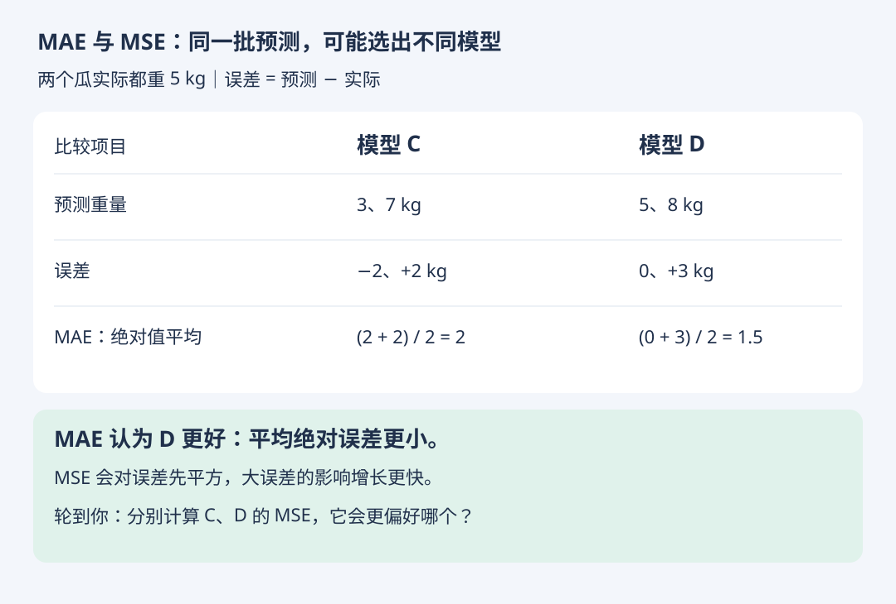

# MAE 与 MSE：评价指标体现了什么偏好

- 学习日期：2026-10-18
- 状态：已讲解，练习待回答
- [上一节：MSE 与 RMSE](regression-mse.md) · [HTML 图解版](mae-vs-mse.html)

## 1. 平均绝对误差 MAE

另一种避免正负误差抵消的方法，是先取绝对值再平均：

```text
MAE = (|预测值1 - 实际值1| + … + |预测值n - 实际值n|) / n
```

MAE 的单位与目标相同。若预测重量以 kg 计，MAE 也以 kg 计。它是平均绝对误差，不是带正负号的平均误差。



## 2. 为什么可能选出不同模型

两个瓜实际都为 5 kg。C 预测 3、7 kg；D 预测 5、8 kg。

- C 的绝对误差是 2、2 kg，MAE = 2 kg。
- D 的绝对误差是 0、3 kg，MAE = 1.5 kg。

按 MAE，D 更好。但平方会放大大误差的影响，所以 MSE 可能给出不同的选择。指标应结合任务对错误的代价来选，并非任何一个都永远更好。

同一数据与单位下可比较模型的 MAE，也可比较 MSE；不要把 MAE 与 MSE 的数值大小直接比较，因为量纲不同。

## 3. 练习（待回答）

1. C 的 MSE 是多少？
2. D 的 MSE 是多少？
3. 按 MSE 应选哪个？它与 MAE 的选择是否一致？
