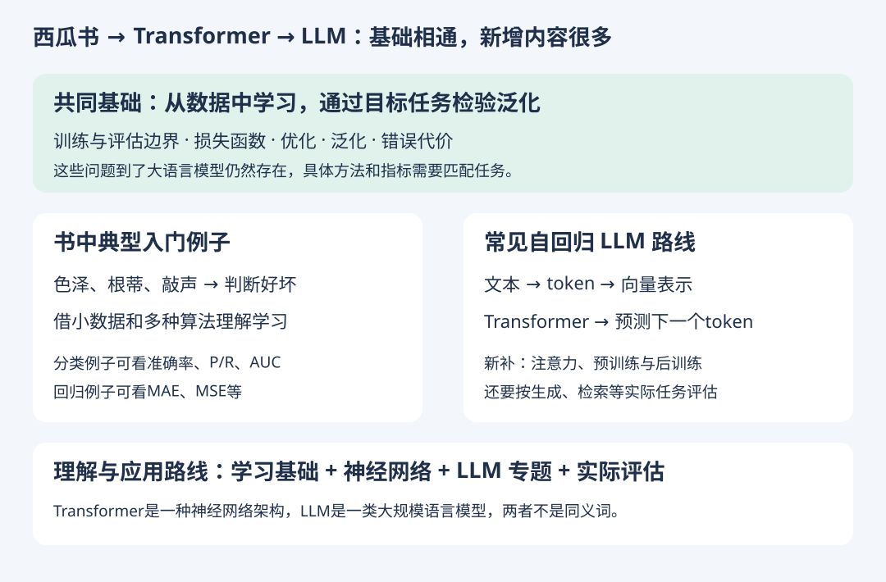

# 西瓜书与 Transformer、LLM：差在哪里

- 记录日期：2026-10-18
- 状态：概念桥接，未将新术语计为已掌握，也不追加题库数量
- [HTML 图解版](ml-to-transformer.html)

## 1. 直接回答

架构、规模和工程实践差别很大，但机器学习的基本问题相通。西瓜书提供通用基础，并不是现代 LLM 的完整教材。

Transformer（通常这样拼写）是一种神经网络架构；LLM 是大规模语言模型这一类模型，不能将二者视为同义词。Transformer 原论文发表于2017年，早于它的西瓜书第一版不包含这套后来的架构。原论文介绍的是用于序列转换任务的、基于注意力的编码器—解码器架构；常见自回归生成式 LLM 使用其后发展的路线，不能把原论文架构与所有LLM直接画等号。[Transformer原论文](https://arxiv.org/abs/1706.03762)

## 2. 哪些知识继续有用

| 已学基础 | 到LLM中要继续问的问题 |
| --- | --- |
| 泛化与过拟合 | 是在新问题上有效，还是记住了训练内容？ |
| 数据划分与泄漏 | 评测题是否进入训练或方案选择过程？ |
| 损失与实际成本 | 训练目标降低，实际任务是否也做得更好？ |
| 指标的适用条件 | 做分类、检索或生成，应分别采用什么评估？ |

并非所有指标都直接照搬：自由文本生成不能普遍用MAE衡量，ROC-AUC也需要有明确正负类与预测分数的任务。若LLM用于分类，这些分类指标仍可使用。

## 3. 要补的桥梁

以常见自回归文本生成模型为例，需要逐步理解：token、向量表示、神经网络训练、注意力、Transformer、预测下一个token的预训练，以及后训练与具体应用评估。

文本本身可构造“前文→下一个token”的训练目标，不必每一条都有人手工标注，这称为自监督学习。它依然有训练目标和损失，并非没有监督信号。这里是补充概念，不要求立即掌握计算。[自回归大语言模型研究实例](https://arxiv.org/abs/2005.14165)

## 4. 针对当前学习目标的建议

目标是借助AI/代码正确理解和运用模型：保留数据、泛化与评估的基础，结合第五章神经网络建立直觉，同时另补LLM专题。不必把全书所有算法推导都学完才允许接触Transformer，也不必把ROC/AUC手算熟练作为进入LLM的门槛。

后续可用“西瓜例子讲基础，同步给一个LLM应用例子”的方式连接，仍以图解与少量选择题为主。
