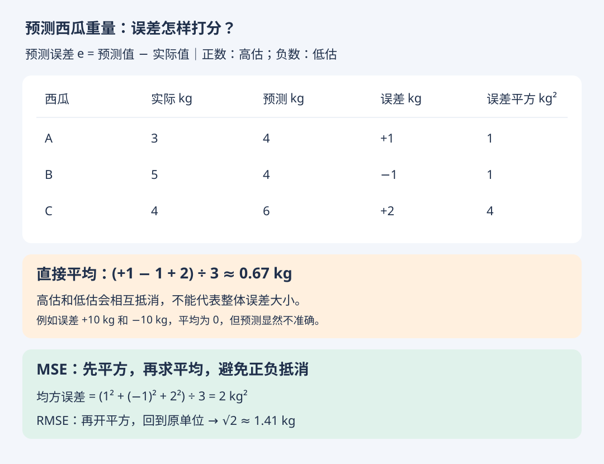

# 回归任务：均方误差 MSE 与 RMSE

- 学习日期：2026-10-18
- 状态：练习已答对（2026-10-18）
- [HTML 图解版](regression-mse.html) · [返回第二章](02-模型评估与选择.md)

## 1. 从分类转到回归

预测好瓜坏瓜是分类；预测西瓜重量是回归。本节讨论数值预测与实际数值相差多远。



规定误差 e = 预测值 - 实际值。高估为正，低估为负。直接平均误差会抵消，更适合观察整体高估或低估的倾向，不能独自反映预测误差大小。

## 2. MSE：均方误差

```text
MSE = [(预测值1 - 实际值1)² + … + (预测值n - 实际值n)²] / n
```

先平方使误差非负，再取平均。比较同一批数据、同一目标单位下的预测结果时，MSE 越小越好；为 0 表示每个预测都等于实际值。计算需要 n > 0。

图中三个误差为 +1、-1、+2 kg，因此 MSE = (1 + 1 + 4) / 3 = 2 kg²。

平方使大误差的影响更明显：误差从 1 增至 3，平方项从 1 增至 9。

## 3. RMSE：均方根误差

```text
RMSE = √MSE
```

例中 RMSE = √2 ≈ 1.41 kg，与预测目标使用相同单位，更容易解释。在同一批数据上，RMSE 和 MSE 对模型的优劣排序相同。

MSE 单位是 kg²，RMSE 单位是 kg；RMSE 不是“绝对误差的平均值”，也不表示每个瓜都相差 1.41 kg。

## 4. 练习（已答对）

同一批两个瓜的实际重量都是 5 kg：

| 模型 | 第一个瓜的预测 | 第二个瓜的预测 |
| --- | --- | --- |
| A | 4 kg | 6 kg |
| B | 5 kg | 7 kg |

分别算 A 和 B 的 MSE。只按 MSE 评价，选哪个？

### 学习者回答

A 的 MSE = (1 + 1) / 2 = 1；B 的 MSE = (0 + 4) / 2 = 2，所以选 A。反馈：正确。重量以 kg 计时，两个 MSE 的单位分别为 kg²。
