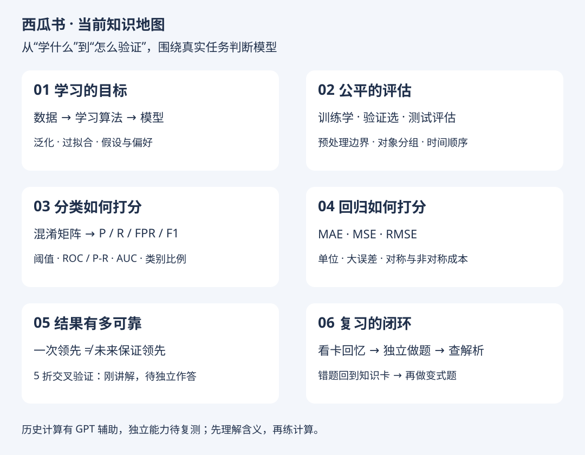

# 阶段复习包：基础概念与模型评估

整理日期：2026-10-18。范围仅为当前对话学过的内容，不能代表第一、二章已经全部完成。本文为自己的教学梳理，不复制原书正文。

[从直觉开始（推荐）](starter.md) · [打开离线复习页面](index.html#starter) · [30 张知识卡](cards.md) · [40 道题库](questions.md) · [答案解析](answers.md) · [返回阅读记录](../README.md)

## 学习状态更正 · 2026-10-18

学习者说明：前面的计算题由 GPT 辅助回答，独立计算尚不熟练；ROC/AUC 目前主要理解为评估工具；MSE/RMSE 目前主要理解为越小越好；MAE 的用途仍需从直觉重讲。

因此，前面的正确答案仅记录“辅助下完成”，不作为独立掌握的证据。后续先练含义、分母、单位，再练简单计算；独立判断前不标记已掌握；计算可借助工具，重点核验含义与运用。

## 1. 当前进度（以下为讲解与辅助作答记录，不代表独立掌握）

| 模块 | 已学习内容 | 当前状态 |
| --- | --- | --- |
| 学习基础 | 样本、特征、标记；分类/回归/聚类；泛化；过拟合；假设空间、版本空间、归纳偏好 | 已讲解，辅助问答记录；不表示第一章全学完 |
| 数据划分 | 训练/验证/测试；预处理泄漏；按对象划分；时间顺序与年度周期 | 已讲解；曾混淆验证与测试，后续已答对 |
| 分类指标 | 混淆矩阵、准确率、P、R、FPR、F1、阈值 | 已有辅助计算答案，待独立练习 |
| 曲线与排序 | ROC、P-R、AUC面积与配对、分数方向、校准的区别 | 主要概念已讲解，计算有GPT辅助，需重练 |
| 类别不平衡 | 正类比例、误报数、查准率、复查容量与查全率约束 | 有辅助作答记录，待独立复测 |
| 回归与成本 | MSE、RMSE、MAE、线性及方向不同的成本 | MSE/RMSE目前理解为越小越好，MAE用途需重讲 |
| 交叉验证 | 5折运行方式、每折预处理、最终测试边界 | 刚讲解，原练习尚未回答；本题库Q38～Q40重点巩固 |

尚未系统展开：正式比较检验、偏差与方差、自助法等；不将其列为已掌握。

## 2. 一页核心公式

约定坏瓜为正类，分数越高越像坏瓜，预测误差 e = 预测值 − 实际值。

| 指标 | 公式/含义 | 注意 |
| --- | --- | --- |
| Accuracy | (TP + TN) / N | 类别不平衡时可能误导 |
| Precision 查准率 | TP / (TP + FP) | 分母是报出的正类 |
| Recall = TPR 查全率 | TP / (TP + FN) | 分母是实际正类 |
| FPR 假正例率 | FP / (FP + TN) | 分母是实际负类 |
| F1 | 2PR / (P + R) | P、R的调和平均；不能替代业务约束 |
| ROC-AUC | Σ ΔFPR × 相邻TPR的平均 | 正负配对胜率，同分计半 |
| AUC配对法 | (排对数 + 0.5×同分数) / (正类数×负类数) | 需同时有正类和负类 |
| MAE | 平均绝对误差 | 原单位，例如 kg |
| MSE | 平均平方误差 | 平方单位，例如 kg² |
| RMSE | √MSE | 原单位；同一数据上与MSE排序相同 |

比率公式需分母非零；未定义时先说明原因，不机械填0。上述F1表达式在P+R为0时需约定处理方式。

## 3. 最容易混淆的 8 组区别

1. 学习算法是方法，模型是结果。
2. 训练全对不保证泛化好；测试集帮助评估，不自动阻止过拟合。
3. 训练负责学习，验证负责选择，测试负责最终评估。
4. 查准的分母是报出者，查全的分母是实际目标，FPR的分母是实际非目标。
5. ROC看误报比例与查全；P-R看查全与查准。
6. AUC看排序；阈值看报出哪些；校准看概率可信度。
7. MAE线性看误差大小；MSE更重罚大误差；实际成本可能还区分方向。
8. 交叉验证每轮重新训练，验证折不参与本轮预处理拟合；最终测试集保留。

## 学习方式约定 · 2026-10-18

以理解与正确运用为主：能说清指标用途、适用条件，能选择评价方案，能检查 AI/代码的输入输出。手算少做且可选，计算题附公式或代入提示，不要求背公式或追求速度。不能把历史 GPT 辅助答案当作独立计算能力的证据，但手算熟练度也不作为理解与应用能力的唯一标准。

## 4. 建议怎么复习

**先从[起步引导](starter.md)的S01开始，一次一道含义题，不要求先做计算。以下40题计划仅作后续参考。**

- 第一次：先看地图，逐张回忆C01～C30，先说答案再展开。
- 优先Q31～Q40：应用与交叉验证，重点说出选择与理由。
- 再做Q21～Q30：识别误区，不必追求计算速度。
- Q01～Q10：概念回忆，可随时查卡片。
- Q11～Q20：可选计算，附公式与代入提示，可用AI/代码代算，再检查单位、范围和含义。
- 每题对照解析，自评“答对/待复习”；错题按题末知识卡编号回看。答对且能解释理由再标记。
- 明天及几天后可重做错题与变式题；这是复习建议，没有创建定时任务。

HTML 的自评记录保存在当前浏览器本地，不自动同步回 GitHub；你在聊天中给出的答案会继续由我更新到仓库。可导出进度备份。

## 5. 原图解入口

- [ROC 与 AUC计算](../roc-auc.md)
- [AUC边界与方向](../auc-ranking.md)
- [AUC与阈值](../auc-threshold.md)
- [类别不平衡](../class-imbalance.md)
- [MSE与RMSE](../regression-mse.md)
- [MAE与MSE](../mae-vs-mse.md)
- [高估低估成本](../asymmetric-cost.md)
- [交叉验证](../cross-validation.md)
