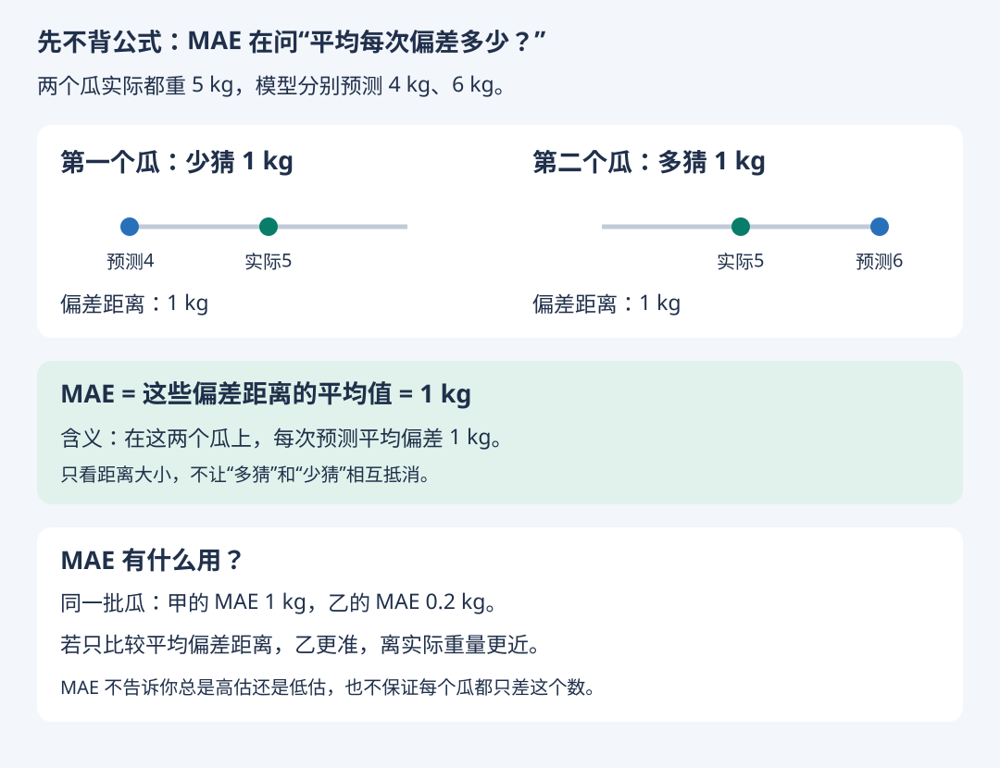

# 从直觉到运用：让工具算，自己判断

整理日期：2026-10-18。[复习总览](README.md) · [离线引导页](index.html#starter)

## 学习状态更正 · 2026-10-18

学习者说明：前面的计算题由 GPT 辅助回答，独立计算尚不熟练；ROC/AUC 目前主要理解为评估工具；MSE/RMSE 目前主要理解为越小越好；MAE 的用途仍需从直觉重讲。

因此，前面的正确答案仅记录“辅助下完成”，不作为独立掌握的证据。后续先练含义、分母、单位，再练简单计算；独立复测前不标记已掌握。

## 学习方式约定 · 2026-10-18

以理解与正确运用为主：能说清指标用途、适用条件，能选择评价方案，能检查 AI/代码的输入输出。手算少做且可选，计算题附公式或代入提示，不要求背公式或追求速度。不能把历史 GPT 辅助答案当作独立计算能力的证据，但手算熟练度也不作为理解与应用能力的唯一标准。

## 先看 MAE 在工作中有什么用



MAE 是“平均绝对误差”。先把它理解成一句话：**在这批数据上，每次预测平均离真实值多远。**

“绝对”只是在说：少猜 1 kg 和多猜 1 kg，偏差距离都是 1 kg，不让它们互相抵消。

用途：在同一批数据、同一种单位下比较模型的平均偏差大小。MAE = 0.2 kg，比 MAE = 1 kg 的平均偏差更小。它不保证每次只差 0.2 kg，也不告诉你偏差方向。

MSE、RMSE 与 AUC 的计算稍后再回到，不要求今天一起掌握。

## 8 道起步单选题

[在页面点击选项作答](index.html#starter)。每题只有一个正确答案；提交后显示对错与解析，可重做。

### S01

同一批瓜：甲 MAE=1kg，乙 MAE=0.2kg。只比较平均偏差距离，哪个更准？

- A. 甲，因为MAE越大越好
- B. 乙，平均离实际重量更近
- C. 两者一样，只要MAE不是0
- D. 无法比较，MAE只能用于分类

### S02

一个瓜少猜1kg，另一个多猜1kg，应该如何理解？

- A. 两个都没猜准，偏差距离都是1kg，方向不会抵消距离
- B. 平均一高一低，说明两个都猜准了
- C. 多猜算错误，少猜不算错误
- D. 少猜与多猜会让MAE为0

### S03

MAE=1kg，意味着每个瓜都恰好差1kg吗？

- A. 是，所有瓜的误差都相同
- B. 是，而且所有瓜都高估1kg
- C. 不是，它表示错误率1%
- D. 不是，它只是多个偏差距离的平均值

### S04

预测重量用kg计，MAE的单位是什么？

- A. kg²，与MSE相同
- B. 百分比，所有指标都是百分比
- C. kg，与预测目标相同
- D. 没有单位，与AUC相同

### S05

查准率主要在问什么？

- A. 实际坏瓜中，找出了多少
- B. 报出的疑似坏瓜中，多少真是坏瓜
- C. 实际好瓜中，误报了多少
- D. 所有预测中，总共错了多少

### S06

查全率的分母应该是谁？

- A. 所有实际坏瓜
- B. 所有报出的疑似坏瓜
- C. 所有实际好瓜
- D. 所有预测正确的瓜

### S07

AUC主要衡量什么？

- A. 每个预测概率是否准确可信
- B. 一个固定阈值下的准确率
- C. 预测重量平均差多少kg
- D. 正类是否排在负类前面，即排序能力

### S08

训练集、验证集、测试集的职责分别是什么？

- A. 选择、最终评估、学习
- B. 学习、最终评估、选择
- C. 学习、选择、最终评估
- D. 三者都可以反复用于选择最高成绩

[独立答案册](answers.md)

## 后续走法

1. 先用 S01～S08 检查含义，每次只答一道，不限速度。
2. 优先做题库 Q31～Q40 应用题与 Q21～Q30 辨析题，回答理由即可。
3. 需要数值时让 AI/代码计算，对照公式提示核对输入、分母、单位与范围。Q11～Q20 手算为可选。
4. ROC/AUC 先理解图的坐标、排序与阈值；知道计算依据即可，不要求熟练手算面积。

40题库是材料储备，不是当前必须完成的考试，也不依据GPT辅助的历史答案推断独立能力。

## 用 AI 或代码算指标时，自己负责这 6 个检查

| 检查 | 要问什么 | 例子 |
| --- | --- | --- |
| 任务目标 | 要预测什么，错误代价是什么？ | 漏检昂贵时关注查全，同时看复查容量 |
| 数据边界 | 这是验证还是最终测试？是否泄漏？ | 预处理只从本轮训练数据拟合 |
| 输入含义 | 正类是谁，分数越高代表谁？ | 计算坏瓜 ROC-AUC，应提供朝向坏瓜的分数，不只提供0/1预测 |
| 指标含义 | 分母、单位、范围是否合理？ | 查全率0～1；MAE单位kg；MSE单位kg² |
| 场景适配 | 类别比例、对象、时间与部署是否相符？ | 新病人按病人分组，未来销量按时间评估 |
| 决策约束 | 这个数字够不够支持使用？ | AUC高不保证查全率≥95%或复查数≤20 |

MAE不是“数学考试分数”：若系统要预测到货重量，MAE可帮助你知道平均偏差大约多少kg，并与可接受误差比较。若有方向不同的代价或严格单次误差上限，不能只看MAE。

### 可复用的计算请求模板

```text
请基于我提供的真实标记与预测结果计算指标，不编造数据。
任务目标：[填写]；正类：[填写]；分数越高代表：[填写]。
数据用途：[验证/最终测试]；划分方式：[对象/时间/其他]。
请说明每个指标的含义、公式、样本数、分母和单位，
检查真实标记与预测逐条对应、是否缺失/重复、是否只含一个类别。
若计算ROC-AUC，请使用方向正确的预测分数，说明同分与未定义情况。
最后结合错误代价及约束：[填写]，解释可做什么决策、还缺什么信息。
```
