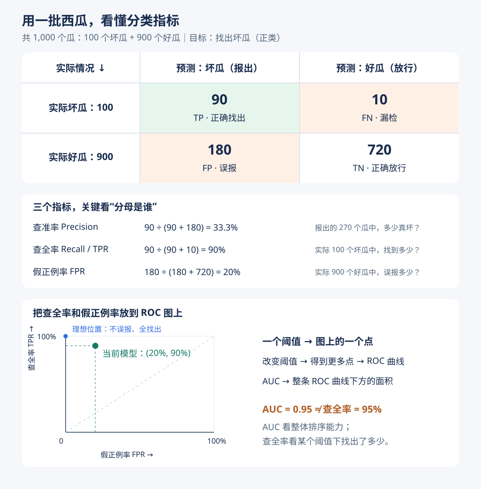
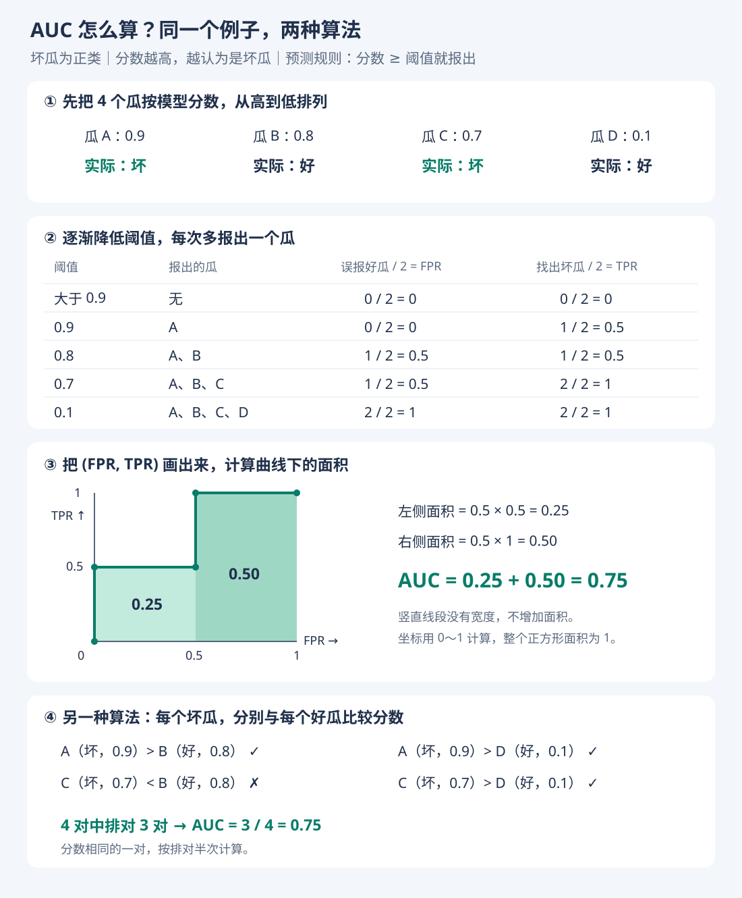

# ROC 与 AUC：用西瓜例子理解

- 学习日期：2026-10-17
- 状态：已学习基础概念，待继续练习
- [浏览器版](roc-auc.html) · [返回第二章](02-模型评估与选择.md)

## 1. 先明确目标与指标

把坏瓜作为正类，模型分数越高，越认为它是坏瓜。分数不一定是校准过的概率。

| 指标 | 公式 | 含义 |
| --- | --- | --- |
| 查准率 Precision | TP / (TP + FP) | 报出的瓜中，有多少真是坏瓜 |
| 查全率 Recall / TPR | TP / (TP + FN) | 实际坏瓜中，找出了多少 |
| 假正例率 FPR | FP / (FP + TN) | 实际好瓜中，误报了多少 |
| F1 | 2 × Precision × Recall / (Precision + Recall) | 同时考虑查准率和查全率 |

TP：正确找出的坏瓜；FN：漏掉的坏瓜；FP：误报的好瓜；TN：正确放行的好瓜。上述比率要求分母非零。



## 2. ROC 是怎样画出来的

预测规则：分数大于或等于阈值，就预测为坏瓜。逐渐降低阈值，依次计算 FPR 和 TPR，画在横轴为 FPR、纵轴为 TPR 的图上。

- 全部预测为好瓜：点为 (0, 0)。
- 全部预测为坏瓜：点为 (1, 1)。
- 理想位置为左上角 (0, 1)：不误报好瓜，并找出全部坏瓜。

## 3. 四个瓜的完整计算

| 瓜 | 实际类别 | 模型分数 |
| --- | --- | --- |
| A | 坏瓜 | 0.9 |
| B | 好瓜 | 0.8 |
| C | 坏瓜 | 0.7 |
| D | 好瓜 | 0.1 |

按阈值下降，ROC 的点依次为：

(0, 0) → (0, 0.5) → (0.5, 0.5) → (0.5, 1) → (1, 1)。



### 方法一：计算面积

左侧面积 = 0.5 × 0.5 = 0.25。

右侧面积 = 0.5 × 1 = 0.50。

**AUC = 0.25 + 0.50 = 0.75。** 竖直线段没有宽度，不增加面积。

一般情况下，把按 FPR 非递减排列的 ROC 相邻点直线连接，按梯形求和：

```text
AUC = Σ (FPR[i+1] - FPR[i]) × (TPR[i] + TPR[i+1]) / 2
```

即每段的“宽度 × 平均高度”。同分样本应在同一次阈值变化中一起纳入。

### 方法二：正负样本两两比较

2 个坏瓜 × 2 个好瓜，一共有 4 对：A>B、A>D、C>D 排对，C<B 排错。

```text
AUC = (排对的对数 + 0.5 × 同分的对数) / (正类数量 × 负类数量)
    = 3 / 4
    = 0.75
```

它衡量随机抽一个坏瓜和一个好瓜时，坏瓜获得更高分的能力；同分按半次正确计。

## 4. 已确认的理解

- 两个坏瓜都排在两个好瓜前面：4 对全对，AUC = 1。
- AUC = 1 表示当前评估数据上排序完美，不保证未来数据上也完美。
- AUC = 0.95 不表示准确率为 95%，也不表示当前阈值下查全率为 95%。
- AUC 衡量跨阈值的整体排序；实际使用仍需结合漏检、误报代价选择阈值。
- 两个模型的 F1 相同，也可能只有一个满足“查全率至少 85%”的要求。

## 5. 下一道练习

- [ ] 如果两个坏瓜的分数都低于两个好瓜，4 对全部排错，AUC 是多少？

## 6. 评估时的注意事项

- 用训练集学习，验证集选择模型与阈值，测试集评估最终方案。
- 填补缺失值等预处理所需统计量，只从训练集学习。
- 同一对象的多张图片按对象划分；预测未来时按时间先后评估。
- 类别严重不平衡时，结合 P-R 曲线与实际误报数量判断，避免只看 ROC-AUC。

本笔记使用教学示例与自己的表述，不包含原书 PDF。

## 学习状态更正 · 2026-10-18

学习者说明：前面的计算题由 GPT 辅助回答，独立计算尚不熟练；ROC/AUC 目前主要理解为评估工具；MSE/RMSE 目前主要理解为越小越好；MAE 的用途仍需从直觉重讲。

因此，前面的正确答案仅记录“辅助下完成”，不作为独立掌握的证据。后续先练含义、分母、单位，再练简单计算；独立复测前不标记已掌握。
