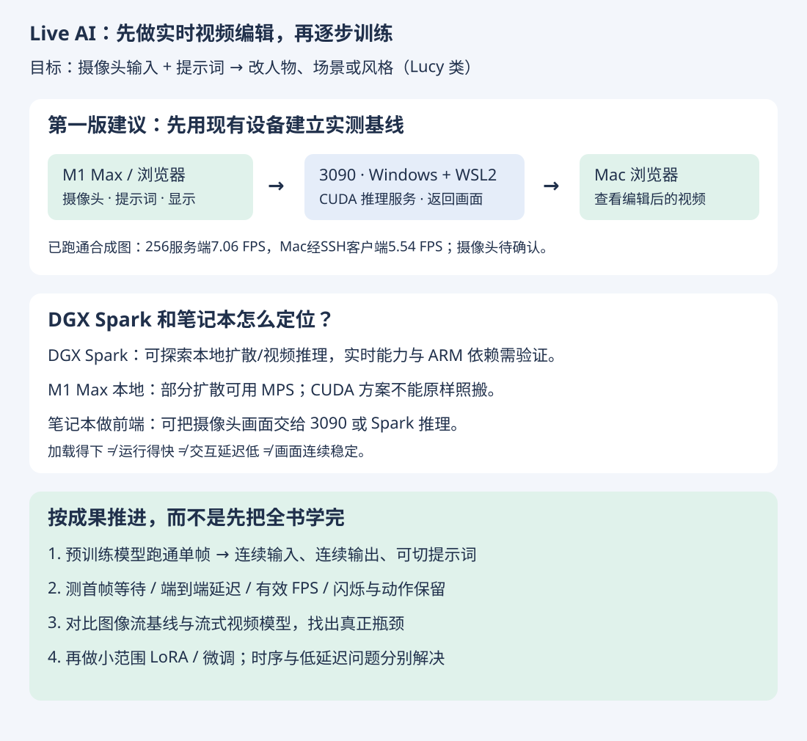

# 实时 Live AI 视频编辑：目标、硬件与第一阶段路线

记录日期：2026-10-18。状态：已通过SSH检查Windows/WSL2与GPU，隔离推理环境正在安装；尚未实测模型或摄像头。本文不是 Decart 内部架构的复现说明。

[HTML 图解](index.html) · [返回学习仓库](../../README.md)

## 1. 已确认的目标与设备

- 目标：Lucy 类——摄像头实时输入，结合提示词改变人物、场景或风格；暂不以 Oasis 类可交互世界为主线。
- 策略：先用现有模型做出效果，再逐步训练自己的适配能力。
- 已有：一张 RTX 3090；两台 M1 Max，每台 64GB；3090 主机运行 Windows，可使用 WSL2。
- DGX Spark：用户询问其可能性，尚未确认已拥有、具体配置或采购意图。
- 偏好：理解与正确运用优先，AI/代码辅助计算，SVG/Markdown/HTML 记录，选择题巩固。



## 2. 核心判断

可以用现有设备开始原型；这不构成达到 Lucy 商用画质、帧率和延迟的承诺。把视频输入接到已有模型、基于模型微调、从零训练基础模型，是不同规模的工作。

Decart 当前公开的 Lucy 实时能力是根据指令编辑直播视频；其产品接口与 SDK 不等于公开全部实时模型权重、训练细节。[Lucy 官方文档](https://docs.platform.decart.ai/models/realtime/lucy-2.5)

## 3. 硬件定位

| 设备 | 对当前任务的判断 | 主要待验证项 |
| --- | --- | --- |
| 现有3090 + Windows/WSL2 | 建议作为第一阶段推理主机，优先建立低分辨率原型；适合探索部分小范围微调 | Windows/WSL与驱动版本、空闲显存、RAM、磁盘、模型与扩展的兼容、实际速度 |
| DGX Spark | 有官方图像/视频扩散运行路径，可作为候选；尚无本项目的实时实测 | ARM64软件包与CUDA扩展、Blackwell适配、模型精度、实际延迟与画质 |
| M1 Max 64GB纯本地 | 部分扩散流程可通过MPS运行；不承诺现成CUDA流式视频项目可原样运行或达到Lucy体验 | 算子与后端支持、所选模型内存占用、延迟、长期散热与吞吐 |
| M1 Max作为客户端 | 推荐用于摄像头、提示词与结果展示，推理放3090；另一台可做数据整理与评估 | 网络时延、视频传输、前后端访问方式 |
| NVIDIA独显笔记本 | 部分轻量方案有可能；须按具体GPU/显存/功耗与模型判断 | 显存是否足够、驱动、散热、功耗限制；不能按桌面同名卡推算 |

3090 的官方显存为24GB；用户机器的可用显存仍需实际检查。[NVIDIA 3090规格](https://www.nvidia.com/en-eu/geforce/graphics-cards/30-series/rtx-3090/)

以128GB版DGX Spark为例，官方列出128GB统一内存、273GB/s带宽与Arm CPU。统一内存容量有助于容纳模型，但不能据此推出比3090更快，也不能把FP4峰值直接当成FP16视频模型性能。[Spark硬件说明](https://docs.nvidia.com/dgx/dgx-spark/hardware.html)

NVIDIA提供Spark上ComfyUI图像与视频生成流程，这证明存在运行路径，不代表该工作流实时输出摄像头编辑。[官方视频生成流程](https://build.nvidia.com/spark/comfyui/video-gen-workflow)

Spark的Arm平台可能需要兼容镜像或重新编译扩展；x86_64二进制包不能按原样通用。[Spark移植指南](https://docs.nvidia.com/dgx/dgx-spark-porting-guide/overview.html)

Diffusers提供Apple Silicon MPS运行方式，但这不保证所有视频模型、第三方CUDA加速项目支持MPS。[Diffusers MPS文档](https://huggingface.co/docs/diffusers/optimization/mps)

## 4. 第一版系统分工

```text
Mac浏览器摄像头 + 提示词
        ↓ 视频输入与控制
Windows主机 / WSL2中的3090推理服务
        ↓ 编辑后的视频
Mac浏览器显示与交互
```

这是工程分工建议，不是多机显存拼接。先不让两台Mac参与同一模型的逐层推理，避免一开始引入跨设备通信复杂度。WSL2对CUDA有官方支持；Windows主机驱动与WSL内开发环境按官方方式配置，不能在WSL里另装Linux显示驱动。[CUDA on WSL官方说明](https://docs.nvidia.com/cuda/wsl-user-guide/index.html)

实际联网部署时再检查摄像头访问、网络路由与安全上下文；这些目前尚未操作。

## 5. 候选技术路线

| 路线 | 作用 | 边界 |
| --- | --- | --- |
| StreamDiffusion + 小型预训练图像模型 | 建立摄像头连续图像变换、提示词控制、测延迟的轻量基线 | 图像流不自动等于时序稳定的视频模型；优先风格变换，不承诺精确换人换衣 |
| StreamV2V | 研究利用过去帧特征提高连续性 | 论文中的GPU测试不能直接套到3090或Spark |
| StreamDiffusionV2 1.3B路线 | 进一步评估因果视频模型与流式缓存 | 官方前提为Linux/NVIDIA；3090、WSL2、Spark实际兼容性与速度待测 |
| Lucy API（可选参考） | 用作质量参考或快速产品对照 | 外部推理服务，不是拥有自己的模型；费用与接入在真正采用前确认 |

[StreamDiffusion官方代码](https://github.com/cumulo-autumn/StreamDiffusion)提供摄像头/屏幕img2img示例；其4090基准不是3090端到端帧率。

[StreamV2V论文](https://arxiv.org/abs/2405.15757)使用过去帧特征库处理流式视频一致性。

[StreamDiffusionV2官方代码](https://github.com/chenfengxu714/StreamDiffusionV2)提供1.3B、14B相关配置和在线demo；本项目优先检查小模型而不是直接选择14B。项目页的多卡H100成绩不能当作单张3090、Spark或M1的成绩。[V2项目页](https://streamdiffusionv2.github.io/)

## 6. 第一阶段验收

用户已接受先200×200展示、单路摄像头风格变换。实际推理尺寸计划比较256级低分辨率实验与512级参考，再缩放显示；兼容性、画质和速度待测。

- 能加载模型并完成单帧变换；再接连续视频。
- 提示词改变时，能看到输出变化，动作仍可辨认。
- 记录首帧等待时间、端到端延迟p50/p95、有效推理FPS与输出帧年龄，而非只看播放器刷新率。
- 检查闪烁、身份与姿态保留、快速动作、遮挡、切换提示词后的恢复。
- 长时间运行后观察队列是否越积越长、显存是否持续上涨。
- 同一组固定录制样本与提示词用于对比，另用未参与调参的测试片段验证。

FPS高不一定延迟低；批处理可能提高吞吐，却让画面滞后。逐像素MSE低也不代表编辑成功：完全不改输入可能获得低差异，却违背提示词。

## 7. 后续训练与学习

先发现具体失败点，再决定训练目标。风格/角色的图像LoRA可作为较小的第一步，但它不自动解决时序闪烁、长期一致性或推理速度。视频微调、蒸馏与因果缓存需分别研究，不能承诺所有方法均在24GB显存下可训练。

学习主线改为：张量和神经网络直觉 → 图像扩散与条件控制 → 视频时序一致性 → 流式推理/缓存/队列 → 数据与小范围训练 → 任务评估。西瓜书保留作泛化、数据边界、优化与评价的基础参考，不要求先学完整本书或熟练手算指标。

## 8. 下一步

已通过保存的SSH连接检查Windows/WSL2，确认WSL内可识别3090。独立venv已创建，PyTorch及图像推理依赖安装中。下一步验证CUDA矩阵计算、下载已固定版本的模型并做256×256合成图推理，然后才验收摄像头。

## 第一版已启动

[第1步：检查Windows/WSL2主机](setup/README.md) · [HTML图解](setup/index.html)

已通过保存的SSH连接完成主机检查，正在独立venv内安装环境。详见搭建记录。
