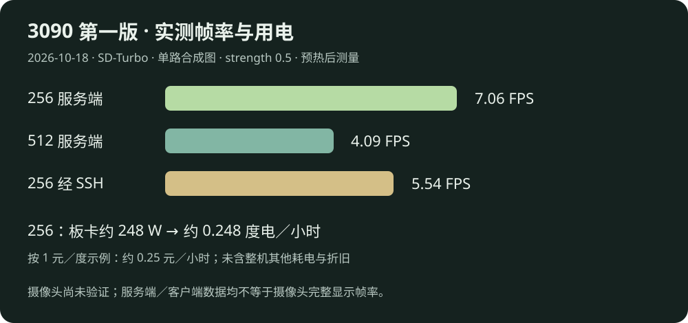
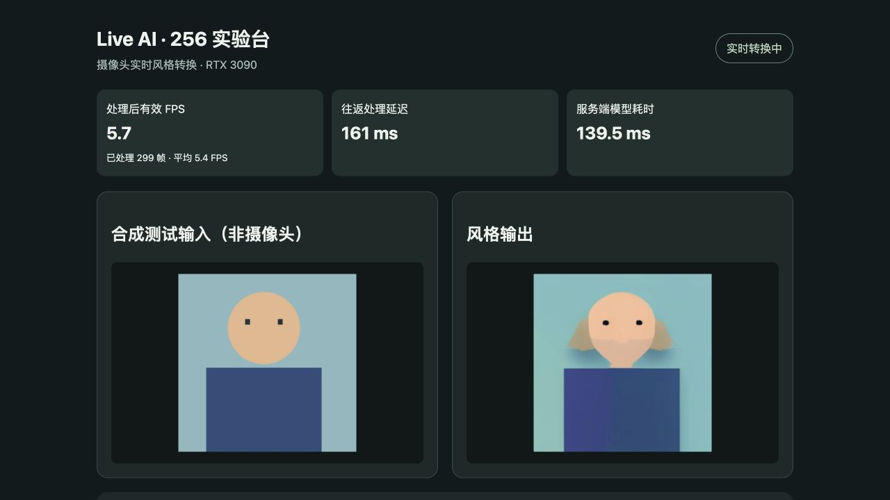

# 3090 第一版实测 · 2026-10-18

[打开HTML图表](index.html) · [返回搭建记录](../../setup/README.md) · [运行代码](../../app/README.md)

第一版已经完成本地模型单帧转换、连续图像流、HTTP/WebSocket和Mac通过SSH连接3090的测试。摄像头入口已实现，但本轮内置浏览器尚未取得摄像头视频流；不能把合成画面测试称为真实摄像头测试通过。

## 测试配置

- Windows 11 + WSL2 Ubuntu 22.04.5，RTX3090 24GB，驱动610.88。
- PyTorch 2.7.1+cu126，Diffusers 0.35.1，Transformers 4.56.2；[完整隔离环境版本](environment.txt)。`pip check`通过。
- 模型：SD-Turbo，固定官方修订 `b261bac6fd2cf515557d5d0707481eafa0485ec2`，fp16 safetensors。未上传权重、凭据或私人画面。
- `num_inference_steps=2`、`strength=0.5`，有效去噪步数1；`guidance_scale=0`，随机种子42，最近提示词embedding缓存。
- 未启用TensorRT、torch.compile或StreamDiffusion加速。该模型按单帧处理，不具备Lucy的视频时序建模。
- 输入为移动合成图形，非真人摄像头。每种尺寸预热3帧，再连续处理至少30秒、至少60帧。
- 未中断其他任务。测试前GPU已用1432 MiB、利用率3%、板卡功耗36.26W；共享机器环境，未保证绝对独占。

## 服务端连续处理

| 项目 | 256×256 | 512×512 |
| --- | ---: | ---: |
| 实测帧数／时长 | 212／30.035秒 | 123／30.055秒 |
| 服务端顺序处理FPS | **7.06** | **4.09** |
| 整帧耗时中位数 | 140.48 ms | 244.84 ms |
| 整帧耗时P95 | 156.83 ms | 278.11 ms |
| 模型耗时中位数 | 138.7 ms | 240.7 ms |
| PyTorch峰值已分配显存 | 2640.6 MiB（约2.58 GiB） | 3096.8 MiB（约3.02 GiB） |
| GPU板卡平均功耗 | 247.96 W | 314.68 W |
| 功耗样本数 | 54 | 53 |

服务端整帧耗时包含合成输入生成、JPEG/base64及`server.infer`，模型耗时不含输入JPEG解码和输出JPEG编码。两者均不包含摄像头、网络和浏览器显示。显存为本进程PyTorch allocator的峰值已分配量，不等于整卡占用或部署所需最小显存，仍要留出CUDA上下文、缓存和其他程序余量。

## Mac → SSH → Windows/WSL WebSocket

| 项目 | 256×256 |
| --- | ---: |
| 实测帧数／时长 | 167／30.146秒 |
| 顺序客户端处理FPS | **5.54** |
| 往返耗时中位数／P95 | 174.01／235.95 ms |
| 提示词切换请求 | 成功返回结果 |

客户端为Mac上的Python测试脚本，包含生成输入、发送、收取及Pillow尺寸校验；不包含浏览器解码绘制、摄像头采集或屏幕扫描。因此也不是完整glass-to-glass延迟。浏览器实测另列在下方，不能与服务端FPS混用。

## 浏览器与摄像头状态

- `http://127.0.0.1:8767` 已通过SSH隧道访问到自有3090服务，健康状态为ready。
- 页面提供摄像头入口、提示词应用、强度与尺寸选择、累计帧数、当前及平均显示FPS。
- 摄像头启动尚未取得视频流，需要在本机浏览器/系统完成权限确认。本轮不记录或上传真人画面。
- 浏览器60秒合成图测试自动结束，共301帧，页面最终显示平均 **5.0 FPS**。运行中截图为299帧、平均5.4 FPS；后段有波动，不能挑选更快瞬间作为最终成绩。浏览器可见性、截图和共享负载均可能影响显示帧率。

[浏览器观察记录](browser-observation.json)

## 成本：实测部分与未知部分

| 口径 | 256×256 | 512×512 |
| --- | ---: | ---: |
| 板卡平均功率折算持续1小时 | 约0.248度电 | 约0.315度电 |
| 示例电价0.6元／度时 | 约0.15元／小时 | 约0.19元／小时 |
| 示例电价1元／度时 | 约0.25元／小时 | 约0.31元／小时 |

上述功耗对应服务端满速连续推理负载，不是浏览器或摄像头低负载模式的独立用电测量。上面两个电价只是计算示例，未核实用户实际电价。功耗来自nvidia-smi采样均值，不是插座电表；包含整张GPU板卡当时的用电，不是严格归属于本程序的独立计量。CPU、内存、主板、硬盘、风扇和电源转换损耗均未计入，因此不能称为整机成本。

已有3090本地运行不产生新的云GPU租金。完整成本还需加：整机实测电费、设备折旧、运行空闲时间、网络与维护。折旧公式为“可摊销设备成本 ÷ 累计使用小时数”，尚未取得这些输入，不编造总成本或毛利。

云租赁对照：截至2026-10-18，Runpod公开列出3090约$0.50／GPU小时。此处是租价参照，并未租用云GPU；不保证该实例有同样的端到端表现，也不代表Lucy/Delulu的运行成本。[Runpod官方价格](https://www.runpod.io/pricing)

原始报告中`idle_gpu_board_watts_mean=129.01`来自模型加载后仅3秒的预采样窗口，不是稳定空闲功耗，不能据此计算程序增量耗电或待机电费。

## 首次安装与启动问题

依赖已安装并验证CUDA矩阵计算。官方权重下载约2.4 GiB，遇到网络超时与一个组件下载中断；保留缓存续传后全部完成。本机也尝试分块下载，但同样受带宽限制，最终使用远端官方缓存；未把本机未完成下载记作哈希校验通过。

随后在离线模式下成功加载本地缓存。第一次单帧模型耗时为7573.9 ms，接着255.7 ms、152.2 ms；首次启动还有本地组件读取等待，均未混入稳定帧率。冷启动与稳定运行需要分别评估。

服务以WSL transient systemd单元`liveai-style-v1.service`运行，脱离SSH安装进程；只绑定localhost，无公网监听。WSL关闭后需要重新启动，未设置开机自启。Mac访问仍依赖SSH隧道。

## 后续验证

1. 在用户本机确认摄像头权限，测真人画面的显示FPS与连续性，不公开上传私人画面。
2. 当前基线约5～7 FPS，距离流畅30 FPS还有差距；下一阶段再对比加速路径和时序稳定性。
3. 若需要完整电费，接插座功率计，记录待机与运行功率及实际电价；若需要总成本，再加入折旧和维护。

[原始服务端数据](benchmark.json) · [原始客户端数据](client-benchmark.json) · [单帧结果](smoke-result.json)

## 合成输入与输出

下图只用于证明本地推理与画面变化，不证明真人效果或身份一致性。256和512动态测试最后一帧的运动位置不同，不能当作严格同帧画质对比。

## 补充验证

HTTP `/api/frame` 已实际返回256×256图像；WebSocket与提示词切换已验证。安装SSH命令退出后，systemd服务仍为active/running，监听地址仅127.0.0.1:8767。三个fp16主权重在3090主机计算的SHA256均与官方LFS摘要一致。[验证记录](verification.json)
