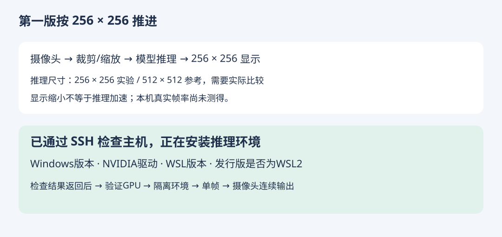

# 第一版搭建记录：3090 + Windows / WSL2

日期：2026-10-18。[返回目标路线](../README.md)

## 已确认的第一版范围

- 使用现有3090，Windows主机、WSL2推理环境。
- 摄像头实时输入，按提示词做风格转换；先不训练基础模型。
- 用户最初接受200×200画面，随后确认先按256×256推进；实际推理尺寸与展示尺寸分别记录。
- 建议比较256×256推理（低分辨率实验）与512×512推理（SD-Turbo模型卡推荐参考），最后缩放为200×200显示。256是否可用、画质与速度仍需在实际机器测试，不能只把512输出缩小就宣称推理更快。
- 不强行把内部推理尺寸设成200×200；尺寸需要适合选定模型与加速后端。不能仅凭200可被8整除就断言整条网络和加速引擎兼容。
- 第一轮优先同一台Windows机器的浏览器localhost与摄像头跑通，减少跨机器网络与摄像头访问变量；之后再接Mac摄像头。摄像头接在哪台机器尚待执行阶段确认，不能当作已有事实。

SD-Turbo支持少步推理，其官方模型卡偏好512×512。较低分辨率可能牺牲语义与人物质量，需实际对比。[官方模型卡](https://huggingface.co/stabilityai/sd-turbo)



## 当前进度

| 步骤 | 内容 | 状态 |
| --- | --- | --- |
| 0 | 确认目标与现有设备 | 已确认 |
| 1 | 检查Windows、驱动、WSL2、RAM与磁盘 | 已通过保存的SSH连接完成 |
| 2 | 验证WSL2中的GPU访问 | nvidia-smi与PyTorch CUDA矩阵计算均已通过 |
| 3 | 建立隔离Python环境并固定依赖版本 | 已完成；PyTorch 2.7.1+cu126、Diffusers 0.35.1、Transformers 4.56.2 |
| 4 | 下载预训练模型，验证单帧转换 | 已完成；本地缓存离线加载与256单帧均通过 |
| 5 | 浏览器摄像头连续输入与256×256展示 | 浏览器合成图已测；用户随后确认真人摄像头跑通，正在试用保留原貌新版 |
| 6 | 提示词切换、延迟/FPS与画面连续性检查 | 合成图连续FPS、功耗和客户端提示词切换已测；真人连续性待验收 |
| 7 | 根据结果优化，再考虑微调 | 未执行 |

## 第1步：只检查，不安装

最初从Mac工作区提供手工检查命令；随后找到已保存的3090连接，已通过SSH完成Windows与WSL只读检查。下面命令保留作复现参考，无需用户重复执行。

在3090那台电脑打开普通PowerShell，依次执行下面四条命令，复制输出回聊天。诊断失败或提示某命令不存在，也请保留原样；先不按网上教程混装CUDA或驱动。

```powershell
Get-CimInstance Win32_OperatingSystem | Select-Object Caption, Version, BuildNumber
nvidia-smi --query-gpu=name,driver_version,memory.total,memory.free --format=csv
wsl --version
wsl --list --verbose
```

若WSL提示需要安装或更新，本步只记录提示，关闭提示即可，不把它记作已安装。正常检查不需要管理员PowerShell。

可选：下载并查看[完整只读诊断脚本](01-check-windows.ps1)，额外输出RAM与各磁盘空闲空间。若系统阻止运行.ps1，不修改执行策略；先复制上面四条命令即可。该脚本没有在真实Windows上运行验证。

## 判断依据

- GPU应识别为RTX3090；标准规格24GB，空闲显存以实际输出为准。
- `wsl --list --verbose`中目标发行版应为VERSION 2；本步不要求所有人已安装Ubuntu。
- `wsl --version`用于了解组件版本，老版WSL可能不支持该参数，不能仅凭这一项就判定GPU不可用。
- `nvidia-smi`表头中的CUDA兼容版本不是“已安装的CUDA Toolkit版本”；后续单独验证PyTorch能否使用CUDA。
- 接下来需要RAM与磁盘空间时再补充检查；不要求现在批量安装Python、Docker、CUDA、TensorRT。

NVIDIA官方明确支持WSL2中的CUDA，并说明WSL内不应另装Linux显示驱动。[CUDA on WSL文档](https://docs.nvidia.com/cuda/wsl-user-guide/index.html)

## 为什么先不固定整套安装命令

上游摄像头示例与加速依赖有特定版本要求。先取得主机状态，再冻结本项目的Python/PyTorch/Diffusers等版本与模型修订。第一阶段可先用PyTorch路径验证，再加入TensorRT，避免把加速编译失败误认为模型不能运行。

[StreamDiffusion摄像头示例](https://github.com/cumulo-autumn/StreamDiffusion/tree/main/demo/realtime-img2img)

## 执行日志

### 2026-10-18：开始步骤1

- 用户选定3090 + Windows/WSL2，接受先200×200画面。
- 已准备本操作指南与只读PowerShell脚本。
- Windows版本、驱动版本、WSL发行版和GPU访问结果：待返回。
- 未安装环境、未下载权重、未启动摄像头、无FPS或延迟实测。

## SSH实测记录 · 2026-10-18

通过本机已有连接记录登录，沿用主机密钥校验；本仓库不保存SSH地址、账号或密码。

| 检查 | 实测结果 |
| --- | --- |
| Windows | Windows 11 专业版，Build 26200 |
| GPU | NVIDIA GeForce RTX 3090，24576 MiB |
| NVIDIA驱动 | 610.88 |
| 检查时空闲显存 | 20105～20106 MiB；瞬时值，不是保留额度 |
| Windows内存 | 63.9 GiB左右（系统报告折算） |
| WSL | 3.0.3.0；发行版 AI3D，VERSION 2，运行中 |
| WSL系统 | Ubuntu 22.04.5 LTS |
| WSL内GPU | nvidia-smi正常识别3090与驱动 |
| Python | 3.10.12；默认解释器未安装torch/diffusers |
| WSL文件系统空闲 | 检查时约824G |
| 本项目目录 | WSL的 /root/liveai-style-v1 |
| 隔离环境 | /root/liveai-style-v1/.venv 已创建 |

为本项目独立安装PyTorch及图像推理依赖，未向系统Python安装这些包，也未修改已有项目的环境。此时安装任务已启动，完成与CUDA矩阵运算结果待后续追加，不能把nvidia-smi成功当作PyTorch已验证。

用户不再需要手动粘贴第一轮检查结果。后续先验证PyTorch CUDA，再测试单帧风格转换。

### 代码与模型源准备

- 已准备[本地图像流基线代码](../app/README.md)，使用SD-Turbo + Diffusers，暂不引入TensorRT和复杂的上游演示依赖。
- 为先排除基础环境问题，先验证标准PyTorch单帧路径；后续再对比StreamDiffusion等流式加速，不声称当前代码已获得其性能。
- 官方模型API可达，修订号已固定为 `b261bac6fd2cf515557d5d0707481eafa0485ec2`。
- 操作页一次只发送一帧；同一时间不积压摄像头帧。不保存真人画面。
- 代码已进行Python/JavaScript语法检查；GPU模型与摄像头联调仍待执行。

### 当前安装任务

依赖安装运行在已保持连接的SSH会话内，日志位于WSL项目目录的 `install.log`。已下载部分CUDA组件，整体安装仍在进行中；尚未取得PyTorch计算通过结果。后续继续从此处检查日志，不重复建立环境。后台启动方式在SSH退出后未继续执行，已改为保持SSH连接的前台安装；没有把首次启动当作安装成功。

[操作页源码](../app/index.html)目前只完成界面检查，未连接模型时显示服务未连接并禁用摄像头启动；不展示伪造帧率。

### CUDA计算验证通过

实际运行 `verify_cuda.py`：PyTorch `2.7.1+cu126`、CUDA运行时12.6、RTX3090，矩阵运算通过。检查时空闲显存23227 MiB（瞬时值）。后续使用 `benchmark.py` 在模型预热后分别进行256和512合成动态图顺序推理，采样GPU板卡功耗。服务器吞吐量、浏览器往返帧率和摄像头完整延迟分别标注，不混用；显卡功耗不冒充整机插座功耗。

### 依赖安装完成，开始权重下载

隔离环境安装完成，安装日志返回 `INSTALL_DONE`。首次加载从官方Hugging Face仓库下载固定版本SD-Turbo，fp16主权重合计约2.4 GiB；远端下载出现读超时后断点续传。同时尝试通过Mac下载同一官方版本、核对LFS SHA256后经SSH传输，避免改用来源不明的模型。权重不提交到公开仓库。

### 本地推理与传输测试通过

官方权重下载完成后，首次加载成功。一个约167MB组件曾因网络中断失败，服务保留已完成缓存重试后补齐；最终在离线模式下运行单帧与连续测试成功。启动阶段遇到本地文件读取等待，随后其他内存占用下降；未把启动等待记入稳定FPS。

256×256服务端212帧／30.035秒：7.06 FPS；512×512为4.09 FPS。模型峰值已分配显存分别2640.6／3096.8 MiB。Mac经SSH WebSocket客户端256测试167帧／30.146秒：5.54 FPS，往返中位数174.01 ms。

板卡功耗分别约247.96／314.68 W。按1元／度的示例电价，256持续运行的板卡用电约0.25元／小时；不是整机电费，也不包含折旧。其他真实电价与插座功耗尚未取得。

服务已改用WSL transient systemd单元`liveai-style-v1.service`运行，脱离安装SSH会话。仅监听localhost，Mac通过SSH隧道访问。未设置开机自启。

[完整实测报告、SVG与原始数据](../benchmarks/2026-10-18/README.md) · [HTML报告](../benchmarks/2026-10-18/index.html)

真实摄像头：已尝试启动，内置浏览器未取得视频流，尚未验收；用户需要在本机浏览器/系统确认摄像头权限。合成图不是摄像头测试，不会据此宣称全部功能完成。

### 浏览器显示验收

内置浏览器完成60秒合成图测试并自动停止，共301帧、页面最终平均5.0 FPS；运行截图记录299帧时平均5.4 FPS。输出确由3090模型生成，不是预制视频。摄像头启动未取得视频流，需用户本机权限/设备确认，不能宣称真人摄像头验收通过。

### 用户确认摄像头跑通，部署保留原貌档

用户确认第一版已跑通，但反馈改动过大。已按要求降低加噪、保留当前原图主体、限幅混合风格残差并对静止区域平滑。新版默认保留原貌档已在同一服务部署，HTTP/WebSocket与档位/分辨率切换通过。部署重启后用户继续在新版试用，此后没有再次打断摄像头或保存私人画面。[调参、SVG、合成样本与实测数据](../tuning/2026-10-18-preserve/README.md)。先前“摄像头待确认”的段落是当时的执行状态，当前以本条用户反馈为准。
