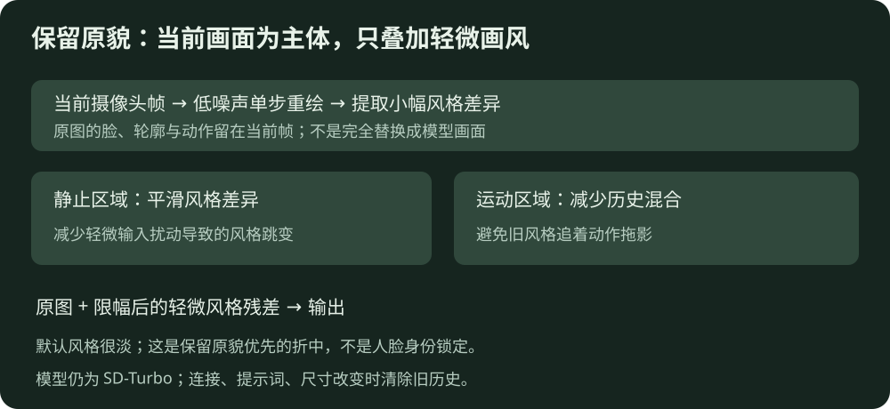
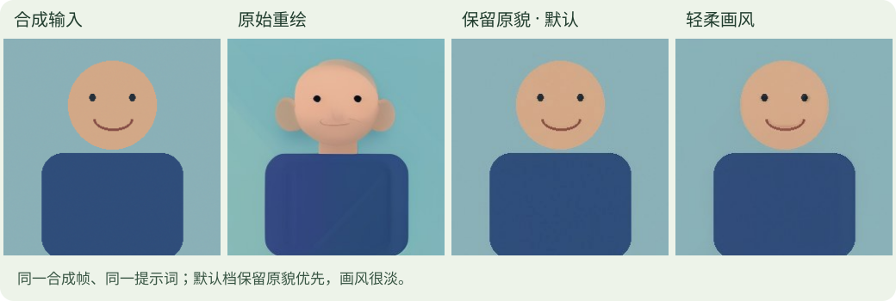

# 保留原貌与减闪烁调整 · 2026-10-18

[HTML / SVG图解](index.html) · [返回项目](../../README.md) · [原始数据](report.json)

用户已确认第一版摄像头跑通，但反馈画面改动过大。本轮目标是保留脸、轮廓与动作，只轻微改变画风。已部署到原3090服务，健康状态版本为`preserve-v2`；默认`preserve`档。模型仍是同一固定版本SD-Turbo，没有新增模型下载或训练。

## 改了什么

| 项目 | 原始重绘对照 | 保留原貌（默认） | 轻柔画风 |
| --- | --- | --- | --- |
| 总时间步网格 | 2 | 8 | 4 |
| strength | 0.5 | 0.125 | 0.25 |
| 实际去噪步数 | 1 | 1 | 1 |
| 风格残差混合 | 全量模型输出 | 25%，并限制幅度 | 40%，并限制幅度 |
| 时序处理 | 无 | 运动门控的风格残差平滑 | 同左，平滑稍弱 |

8个总时间步不意味着执行8次模型前向：`int(8×0.125)=1`。同时调整网格与strength，才能降低加噪程度而不出现0个有效步。旧版2步时不能简单把strength调成0.1。[SD-Turbo官方说明](https://huggingface.co/stabilityai/sd-turbo) · [Diffusers图生图接口](https://huggingface.co/docs/diffusers/v0.35.1/en/api/pipelines/stable_diffusion/img2img)

默认提示词改成自然照片、原有表情、轻微调色和皮肤纹理。文字里的“same person”不是身份锁；保留原貌主要依靠以下工程限制：

1. **低幅度重绘**：先降低模型改动输入的机会。
2. **保留当前原图主体**：取模型输出相对原图的低频风格差异，轻度模糊这个差异，避免把模型新画的眼睛、嘴巴等细节整体替换进来。
3. **限制风格残差**：默认将每个颜色通道的残差限制在±48，再混合25%；JPEG输出前，最终对当前输入的逐通道改动最多约±12／255。25%混合不是“人脸相似度25%”，也不是保留程度的语义概率。
4. **只平滑风格残差**：历史权重按原图的逐像素变化降低，明显运动处不用旧残差；当前原图不做整帧历史叠加，因此动作主体来自当前帧。
5. **重置与隔离**：场景整体变化大、停顿超过1秒、分辨率/提示词/档位切换时不沿用旧历史。每条WebSocket连接独立保存临时历史，断线释放；HTTP单帧请求不共享时序历史。不保存摄像头图片。

默认风格会非常淡，接近轻微调色；如果需要更明显，可选择“轻柔画风 · 稍明显”。“原始重绘 · 对照用”保留作比较，默认不选。

## 同一合成序列对比

从左到右：输入、原始重绘、保留原貌默认档、轻柔画风。输入是代码绘制的合成人像，不是用户照片。三档使用同一提示词和相同20帧序列：前12帧静止并带轻微随机像素噪声，后8帧每帧平移4像素。每档预热3帧，均为256×256、单个有效去噪步，固定随机种子。

| 诊断项 | 原始重绘 | 默认保留 | 轻柔画风 |
| --- | ---: | ---: | ---: |
| 当前测试服务端顺序FPS | 5.86 | 5.29 | 5.56 |
| 整帧耗时中位数 | 167.83 ms | 188.48 ms | 175.99 ms |
| 输出相对输入的像素MAE | 8.909 | 0.762 | 1.539 |
| 静止段相邻帧“风格残差变化”MAE | 2.234 | 0.433 | 0.558 |

像素尺度为0～255。默认档的输入改动MAE比原始重绘低约91.4%，静止段残差变化低约80.6%。这是合成样本上的像素诊断，**不是人脸身份相似度或真人视频闪烁评分**。这些下降部分来自主动限制修改幅度，不能解释成模型生成能力提高；原样输出也能得到很低MAE，但几乎没有画风。本轮是用户明确选择保留原貌优先的折中。

本次20帧短测不是长期稳定性或严格速度排名；测试顺序与共享负载也会影响速度，不能把三档不足1 FPS的差异直接归因于算法。历史第一版7.06 FPS来自另一轮30秒测试，也不应与本轮当作完全相同条件比较。

## 验证与部署

- 三项独立检查通过：模型极端改动仍受幅度限制、运动/换提示词不拖入旧残差、静止风格变化被平滑且过期历史失效。
- 实际GPU合成序列对比通过，图片及原始JSON保存在本目录；脚本为[benchmark_preserve.py](../../app/benchmark_preserve.py)。
- HTTP未指定profile时实际返回`preserve`、有效步数1。
- WebSocket连续请求、档位切换、256↔512切换均实际返回正确大小和档位。
- 运行服务已重启，`/health`返回`preserve-v2`、`default_profile=preserve`、`ready`。新版页面默认选择“保留原貌 · 极轻画风（推荐）”。
- 部署重启曾短暂断开旧服务；用户已在新版页面继续试用摄像头，此后未再刷新或停止它，未对私人画面截图或上传。真人保留程度和画风自然度仍由用户视觉验收，本轮不编造真人身份评分。

旧版`server.py`和`index.html`已在3090项目目录的`backups/fb88c36/`保留备份。代码、参数、验证方法和局限记录到本仓库；权重、连接凭据、摄像头画面未提交。

## 局限

这次是低噪声、原图残差混合与运动门控的轻量改进，没有加入人脸识别、身份适配器、分割、光流对齐或视频时序模型。快速运动、光照跳变和遮挡仍可能导致局部闪烁；固定种子也不能彻底消除它们。若后续目标变成大幅换衣/换场景又保住脸，需要额外的结构与身份条件，不能只不断增强提示词。
